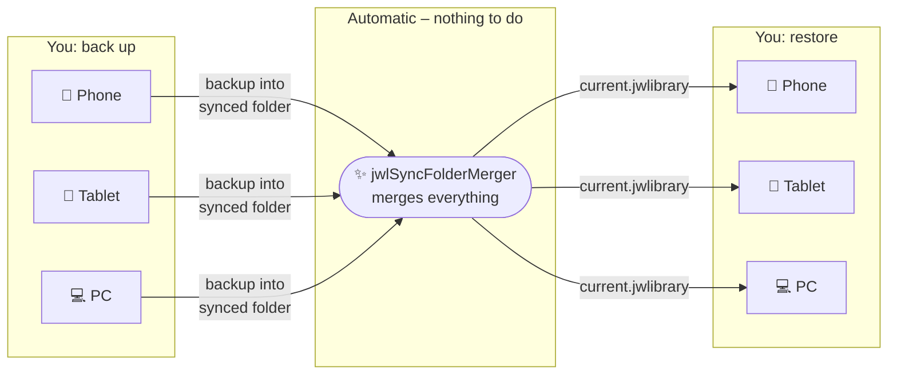
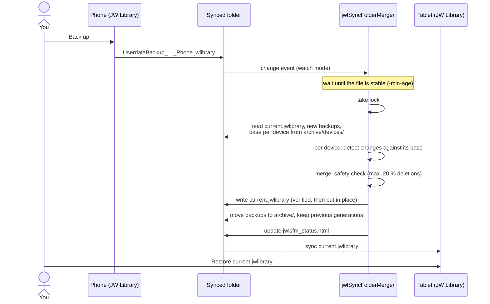

# jwlSyncFolderMerger

[](https://github.com/chaosben/jwlSyncFolderMerger/actions/workflows/ci.yml)
[](LICENSE)

Automatically merges the JW Library backups (`.jwlibrary`) of several devices into
one common state – without any user interaction. It is meant for a synchronised
folder (e.g. Syncthing) that all devices use to exchange their backups.



**That's all:** back up as usual, restore `current.jwlibrary` – your notes,
highlights and bookmarks from all devices are merged.

## Workflow

1. A device creates a backup in JW Library and saves it into the synced folder.
2. jwlSyncFolderMerger merges all new backups with the previous state and writes
   `current.jwlibrary` – automatically (watch mode, service) or when you call it.
3. The devices restore `current.jwlibrary` in JW Library.

If there are no new backups, a run changes nothing.



## Scenarios

Whatever you choose: **exactly one machine runs jwlSyncFolderMerger** for a folder.
All other devices only drop their backups into the folder and restore
`current.jwlibrary`.

### 1. Always-on server in your Syncthing network (recommended)

You already have a small machine that is always on and part of your Syncthing
world – a Raspberry Pi, a NAS, a home server, a VPS. It shares the backup folder
with all your devices anyway, so it simply does the merging as well:

- run `jwlSyncFolderMerger -watch -sync syncthing <folder>` as a service
  (Linux: [systemd](#linux-and-raspberry-pi)),
- a new backup from your phone arrives on the server and is merged automatically
  (usually within about two minutes, see `-min-age`); `current.jwlibrary` is on all
  devices a moment later,
- no desktop needs to be running.

A Raspberry Pi Zero is enough; the tool needs little memory and no other software.

### 2. A PC that is running anyway

No server? Let your desktop or laptop do it. Start the watch mode at log on
([Windows](#windows), [macOS](#macos), [Linux](#linux-and-raspberry-pi)). Backups
from other devices wait in the folder until the PC is on and are merged then.

### 3. Manually, when you need it

You do not want anything running in the background: call the tool when you are
about to restore a device, e.g. after creating backups on your phone and tablet.

```
jwlSyncFolderMerger -dry-run -sync syncthing <folder>   # look first: what would happen?
jwlSyncFolderMerger -sync syncthing <folder>            # merge
```

A run without new backups does nothing, so calling it too often does no harm.
A timer (cron, Task Scheduler) running this every few minutes is the middle
ground between manual and watch mode. Manual and timer runs do not update the
tool by themselves; run `jwlSyncFolderMerger -update` now and then (see
[Automatic updates](#automatic-updates)).

### 4. Other sync tools

Nextcloud, OneDrive, Dropbox, Google Drive, rclone, …: use the same setup with
`-sync generic` on a machine where the folder is a **local** synced folder (the
tool needs change events and fast file access; it does not talk to the cloud).

## Installation and start

### Download

Take the archive for your system from the
[releases page](https://github.com/chaosben/jwlSyncFolderMerger/releases) (built
automatically for every version):

| Archive suffix                   | Platform                                                         |
|----------------------------------|------------------------------------------------------------------|
| `linux_amd64`                    | Linux PCs and servers                                            |
| `linux_arm64`                    | Raspberry Pi 3/4/5 with 64-bit Raspberry Pi OS, other ARM64 boards |
| `linux_armv7`                    | Raspberry Pi 2/3/4 with 32-bit Raspberry Pi OS                   |
| `linux_armv6`                    | Raspberry Pi Zero / Zero W / 1                                   |
| `windows_amd64`, `windows_arm64` | Windows                                                          |
| `darwin_amd64`, `darwin_arm64`   | macOS (Intel / Apple Silicon)                                    |

The archive contains a single executable without dependencies plus the
`integrations/` folder. Alternatively build it yourself, see [Development](#development).

You only download it once: in watch mode the tool installs new releases by itself
(see [Automatic updates](#automatic-updates)). For that, put the executable in a
directory your user can write to – the locations used below
(`~/.local/bin`, `%LOCALAPPDATA%\jwlSyncFolderMerger`, `~/bin`) are.

In all examples, `<folder>` is the synced backup folder.

### Linux and Raspberry Pi

On a Raspberry Pi, `uname -m` tells you the archive: `aarch64` → `arm64`,
`armv7l` → `armv7`, `armv6l` → `armv6`.

```sh
install -Dm755 jwlSyncFolderMerger ~/.local/bin/jwlSyncFolderMerger
~/.local/bin/jwlSyncFolderMerger -dry-run -sync syncthing ~/Sync/JWLibrary   # manual check
```

**As a service** (scenarios 1 and 2) – systemd user service, details in
[integrations/systemd](integrations/systemd/):

```sh
install -Dm644 integrations/systemd/jwlSyncFolderMerger-watch@.service \
  ~/.config/systemd/user/jwlSyncFolderMerger-watch@.service
install -Dm600 integrations/systemd/example.env ~/.config/jwlSyncFolderMerger/jwlibrary.env
$EDITOR ~/.config/jwlSyncFolderMerger/jwlibrary.env          # JWLSFM_DIR, JWLSFM_SYNC
systemctl --user daemon-reload
systemctl --user enable --now jwlSyncFolderMerger-watch@jwlibrary
loginctl enable-linger "$USER"     # keep running without login (servers, Raspberry Pi)
journalctl --user -u jwlSyncFolderMerger-watch@jwlibrary -f   # logs
```

**As a timer instead** (no permanent process), e.g. with cron every 10 minutes:

```
*/10 * * * * $HOME/.local/bin/jwlSyncFolderMerger -sync syncthing $HOME/Sync/JWLibrary >> $HOME/jwlSyncFolderMerger.log 2>&1
# timer runs do not update themselves – check for a new release once a day:
17 4 * * *   $HOME/.local/bin/jwlSyncFolderMerger -update >> $HOME/jwlSyncFolderMerger.log 2>&1
```

### Windows

Copy `jwlSyncFolderMerger.exe` to `%LOCALAPPDATA%\jwlSyncFolderMerger\`.

**Manually** in PowerShell:

```powershell
& "$env:LOCALAPPDATA\jwlSyncFolderMerger\jwlSyncFolderMerger.exe" -dry-run -sync syncthing "C:\Users\me\Sync\JWLibrary"
```

**Automatically at log on** (no window, restart on failure) – details in
[integrations/windows](integrations/windows/):

```powershell
.\integrations\windows\install-task.ps1 -Folder "C:\Users\me\Sync\JWLibrary"
Start-ScheduledTask -TaskName "jwlSyncFolderMerger watch"
```

The log is written to `%LOCALAPPDATA%\jwlSyncFolderMerger\watch.log`.

### macOS

```sh
mkdir -p ~/bin && cp jwlSyncFolderMerger ~/bin/
xattr -d com.apple.quarantine ~/bin/jwlSyncFolderMerger   # downloaded binaries are blocked otherwise
~/bin/jwlSyncFolderMerger -dry-run -sync syncthing ~/Sync/JWLibrary
```

**Automatically at log on** with launchd – details in
[integrations/macos](integrations/macos/).

### Syncthing tips

- Share the backup folder with every device that uses JW Library and with the
  machine running the merger.
- Keep Syncthing's file watcher enabled (default) – otherwise `current.jwlibrary`
  is only distributed at the next full scan (default: hourly).
- The `archive/` subfolder is only needed on the merger machine. To save space on
  phones and tablets, add `archive` to the folder's ignore patterns on those
  devices (Syncthing ignore patterns are per device).
- File versioning in Syncthing is a welcome extra safety net.

## Folder layout

```
<folder>/
  current.jwlibrary                       result – restore this backup on the devices
  jwlsfm_status.html                      status page – open it in a browser
  UserdataBackup_…_<device>.jwlibrary     new device backups (any file name)
  archive/devices/<device>.jwlibrary      last processed backup per device
  archive/generations/current_*.jwlibrary previous results (default: 5)
```

Processed backups are moved to the archive or deleted. Files that are still being
synchronised (`-min-age`), unreadable, or have an unknown schema are left untouched.

## Status page

The tool usually runs unattended on another machine. To see what it is doing,
open `jwlsfm_status.html` in the backup folder – your sync tool brings it to every
device, so a browser or file manager on your phone is enough.

- **At the top**: the overall state (ok / warning / error, with the error message),
  machine and version, watch mode or one-off runs, automatic updates, the last run
  and the last merge, the content of `current.jwlibrary`, and every known device
  with its last backup and whether it has restored the current `current.jwlibrary`.
- **Below**: the most recent events, newest first – merges, processed backups that
  changed nothing, aborts by the safety check, errors, warnings, installed updates,
  start and stop of the watch mode. Runs without new backups only refresh the top
  part; the same warning or error is listed at most once a day.
- `-status-entries` sets how many events are kept (default 50); `0` turns the page
  off. `-dry-run` never writes it.
- In watch mode the page states by when it will be rewritten at the latest; if it is
  older than that, it shows a warning that the tool is probably not running.

The page is a single self-contained file without external resources; it also
stores its own data, so one-off runs continue the same event log.

## How merging works

The tool compares every device with its last known state and only takes over what
has **changed** there:

- **Highlights** are decided per paragraph: if a device changed the highlights of a
  paragraph, the most recent change wins – a paragraph always comes completely from
  one device, never mixed.
- **Notes**: for the same note, the newer modification time wins.
- **Deletions** are detected and propagated (including cleaning up displaced
  highlights after a publication update).
- **Bookmarks**: on a slot conflict the older bookmark moves to a free slot.
- **Tags, input fields, playlists** including images are merged as well.
- A device without a known starting point (new, or never restored `current`) can
  only add, never delete.

How does the tool know that a device restored `current`? `current` contains an
invisible generation marker (a Location row with KeySymbol `jwlSyncFolderMerger`)
that JW Library keeps when restoring and in its next backup.

## Safety

- The new `current` is written completely, verified (SQLite integrity, foreign
  keys, reading it back) and only then put in place; cleanup happens afterwards.
- If a run would delete more than 20 % of all highlights or notes, it aborts
  without changes (exit code 2, `-max-delete-ratio`).
- Previous results stay in `archive/generations`.
- A lock file prevents parallel runs. **Run the tool on one machine only.**

## Usage

```
jwlSyncFolderMerger [flags] <folder>
jwlSyncFolderMerger -update [-dry-run]

  -dry-run                only report what would happen
  -sync generic|syncthing conventions of the sync tool (temp/conflict files)
  -min-age 2m             skip newer files (sync may still be running)
  -keep-generations 5     number of archived results
  -max-delete-ratio 0.2   protection against mass deletion
  -device-expiry-days 180 forget devices without a new backup
  -no-marker              no generation marker (disables restore detection)
  -watch                  keep running and merge whenever new backups arrive
  -debounce 15s           watch mode: quiet time after the last change
  -poll 0                 watch mode: polling interval (0 = 6h with change events, 5m without)
  -no-auto-update         watch mode: do not install new releases automatically
  -update-interval 24h    watch mode: how often to check for a new release (at least 1h)
  -update                 install the latest release and exit (with -dry-run: only check)
  -status-entries 50      events kept on the status page (0 = no status page)
  -log-format text|json, -v, -version
```

Exit codes: `0` ok (also "nothing to do" and "already running"), `1` error,
`2` aborted by a safety check.

## Watch mode

With `-watch` the tool keeps running and reacts to filesystem change events:
a new backup in the folder triggers a merge after `-debounce`. Sync tools that
write to a temporary name and rename at the end (Syncthing does) are handled
naturally; backups that are still changing are retried after `-min-age`.
The tool's own writes (`current.jwlibrary`, `archive/`) do not trigger runs.

- It runs once at start, then on changes and as a safety net every `-poll`.
- Where the filesystem delivers no change events (network mounts, a Windows drive
  under WSL) it polls every 5 minutes instead.
- A run aborted by the safety check is not repeated until the next backup arrives;
  other errors are retried with increasing delay.
- A missing folder at start is an error (exit code 1); later outages are retried.
- Stop with Ctrl+C / SIGTERM (exit code 0).
- New releases are installed automatically, see [Automatic updates](#automatic-updates).

Service configurations and adding sync tools: see [integrations/](integrations/).

## Automatic updates

Like Syncthing, the watch mode keeps itself up to date:

- It checks GitHub for a new release right after the start (before the first merge)
  and then every `-update-interval` (default 24 hours, at least 1 hour). A failed
  check (e.g. no network yet after booting) is retried after an hour.
- It only installs a newer release of the **same major version** (e.g. 1.2.0 → 1.3.0).
  A new major version may change behaviour; the log says so, and you update manually.
- Every download is verified before anything is replaced: `checksums.txt` must carry
  a valid [minisign](https://jedisct1.github.io/minisign/) signature from the release
  key built into the program ([keys/release_sign.pub](keys/release_sign.pub)), the
  archive must match its checksum, and the new executable must report the expected
  version.
- The executable is replaced and the process restarts itself with the same arguments
  (on Linux and macOS with the same process id, on Windows the old process waits for
  the new one). Updates only happen between merges, never during one.
- No update happens with `-no-auto-update`, with `-dry-run`, for self-built
  development versions, or if the executable's directory is not writable (e.g.
  installed by a package manager) – the log says why at start.
- The tool contacts `api.github.com` and `github.com` for this, nothing else.
- You see what happened in the log and on the [status page](#status-page): whether
  automatic updates are on (or why not), each installed version ("New version
  installed … restarting", followed by "Watch mode started, version …") and failed
  update checks as warnings.
- On Windows, the replaced executable is kept as `jwlSyncFolderMerger.exe.old-…`
  while the old process is still waiting; such files are removed at the next start.
- To turn updates off in a service, add `-no-auto-update` to its arguments – see the
  README of [systemd](integrations/systemd/), [Windows](integrations/windows/) or
  [macOS](integrations/macos/).

One-off runs (manual, cron, Task Scheduler) never update by themselves. Use
`jwlSyncFolderMerger -update` (or `-update -dry-run` to only check); it exits with
`0` when the tool is up to date or was updated and `1` on errors.

To verify a downloaded release by hand:

```
minisign -Vm checksums.txt -p keys/release_sign.pub
sha256sum --ignore-missing -c checksums.txt
```

## Limitations

- Merging is content-neutral: highlights are anchored to paragraph numbers and
  token positions, not to text. Highlights displaced by a publication revision
  are not re-anchored.
- Two devices with the same device name are treated as one device.
- Supports database schema 14–16; the result uses the highest schema of the inputs.

## Development

```
go test ./...                       # unit and scenario tests (synthetic data)
CGO_ENABLED=0 go build -o jwlSyncFolderMerger ./cmd/jwlSyncFolderMerger

# cross-compile, e.g. for a Raspberry Pi with 32-bit OS:
GOOS=linux GOARCH=arm GOARM=7 CGO_ENABLED=0 go build -o jwlSyncFolderMerger ./cmd/jwlSyncFolderMerger

# Tests with real backups (local only, the folders are only read):
JWLSFM_REALDATA=/path/to/backups go test -tags realdata ./internal/dbwrite
JWLSFM_HISTORY=/dir1,/dir2      go test -tags realdata -run Replay -v ./internal/app
```

Releases are built automatically by GoReleaser when a `v*` tag is pushed.
`checksums.txt` is signed with minisign; the secret key is the repository secret
`MINISIGN_SECRET_KEY` (a key without password, `minisign -G -W`), its public key is
[keys/release_sign.pub](keys/release_sign.pub) and must match
`internal/selfupdate/keys.go` (a test checks this). To rotate the key, add the new
public key to `keys.go`, release once, then switch the secret.

## License

[MIT](LICENSE)
